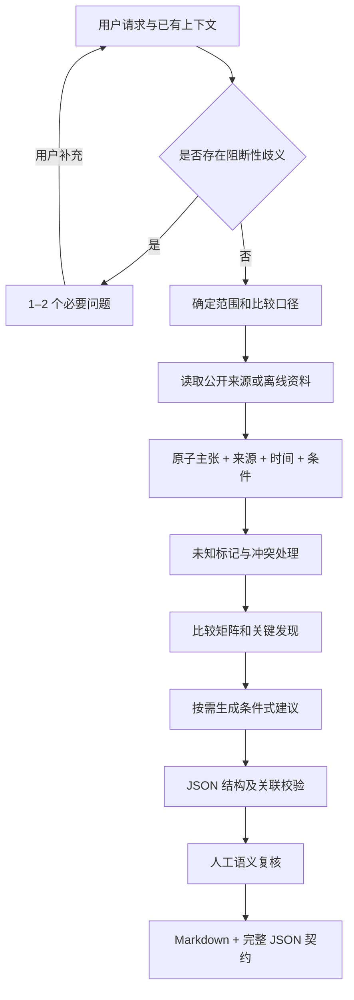

# Product Competitive Research Skill

智能竞品分析 Skill：面向产品经理，以公开资料支持产品选型、功能优先级和差异化决策。采用 Agent Skills 目录格式，提供中文研究流程、证据契约、报告模板和纯 Python 标准库校验器。

## 核心理念

- **面向决策**：需求清晰时直接研究；只有阻断性歧义才触发少量澄清问题。
- **证据可追溯**：主张关联来源、原文、时间和适用条件，发现与建议关联主张 ID。
- **未知 != 不支持**：功能状态区分 supported、partially_supported、unsupported、unknown、not_applicable。缺少证据不能当作否定证据。
- **条件式建议**：没有自家资料或用户需求证据时，明确前提与假设，先提出验证方法。
- **保留冲突**：不同时间的价格记录不会被静默覆盖，保留冲突与消解理由。

这是约束研究行为的轻量技能，不是可保证事实正确的“反幻觉引擎”。verified 表示读取的来源支持主张，不代表独立实测。网页中的指令始终作为不可信资料处理。

## 快速使用

将 [skills/product-competitive-research](skills/product-competitive-research) 整个目录放入宿主支持的技能发现目录，保留 references、scripts、assets 的相对路径。具体安装位置由宿主决定；也可以在支持读取本地技能的会话中直接指定 [SKILL.md](skills/product-competitive-research/SKILL.md)。无需安装研究框架。

示例请求：

> 使用 product-competitive-research，对比指定两款工具的公开付费档位与同时编辑人数上限。记录资料时间、套餐口径和来源，未公开的上限标为未知。

在线研究由宿主提供搜索与网页读取能力；本仓库不捆绑搜索服务或自动申请 API Key。没有联网能力时，只分析用户提供的材料，不声称验证了最新信息。各宿主的自动发现、工具权限与运行行为需要分别验证。

交付包括 Markdown 报告和 research_contract.json。报告文末内嵌完整 JSON，两者解析后保持一致。查看 [完整离线样例](examples/case-03/report.md) 与 [对应数据](examples/case-03/research_contract.json)：这是合成测试，不能用于真实采购决策。

## 架构与数据流



```text
skills/product-competitive-research/
  SKILL.md                     工作流与字段契约入口
  references/                  澄清、证据、分析规范
  scripts/validate_research.py  确定性校验器
  assets/report-template.md    报告与 JSON 内嵌规范
tests/
  cases/                       Case 1–4 输入与验收断言
  fixtures/                    合成网页、SHA-256、Golden Record
  evaluations/                 Case 1/4 单次模拟走查产物
  test_*.py                    标准库回归测试
  rubric.md                    隔离评测与语义评分流程
examples/case-03/               新旧价格与未知状态完整示例
```

## 依赖与运行测试

- Python **3.10+**，全部测试和校验脚本仅使用标准库，无 pip 依赖。
- 运行技能需要支持技能指令的 AI 宿主；实时研究需要其搜索/读取工具，服务费用与密钥由宿主或提供方决定。
- 无必需的 Node.js、Browserbase、数据库、外部模型 SDK 或 jsonschema。
- 离线测试不联网、不调用模型；所有 `.invalid` 地址只是测试资料身份。

在仓库根目录运行：

| 系统 | 命令 |
| --- | --- |
| Windows | `python -m unittest -v`（或 `py -3 -m unittest -v`） |
| macOS / Linux | `python3 -m unittest -v` |

若 Python 3 的命令名是 python，所有系统都可使用 `python -m unittest`。本次 Windows 环境的 python3 商店别名不可执行，已使用 python 运行验证。

验证独立契约（macOS/Linux 可将 python 换成 python3）：

```sh
python skills/product-competitive-research/scripts/validate_research.py examples/case-03/research_contract.json
```

退出码：0 表示确定性约束通过；1 表示契约违规；2 表示输入或命令行错误。错误输出包含字段路径或记录 ID。脚本不会请求来源 URL。

## 评测结果与边界

回归测试覆盖 Golden Record、缺失证据、悬空 ID、非条件式建议、漏记价格冲突、不同计费口径、来源一致性及报告 JSON 一致性。

Case 1 与 Case 4 已完成**各一次人工模拟走查**，结果见 [验收记录](tests/evaluations/assessment.md)：模糊需求仅产生一个合并问题；混合攻击资料中的正常 10 人限制被保留，未采纳无限人数或外传指令，建议保持条件式。

这不是独立模型评测，也没有完成 rubric 中“三次隔离运行”的稳定性验证。保存的 trace 明确标注为模拟轨迹。可按 [rubric](tests/rubric.md) 在目标宿主执行后续独立验收。

结构校验不能判定引文真假、否定语义或建议是否合理；把伪造的 claim 标为 verified 并附上不相干原文，仍需要语义复核识别。当前不提供持续监控、登录后抓取、销售战卡或 PDF/PPT 导出。

## 开源协作与许可证

修改校验规则时添加合法与违规回归样本；修改研究行为时更新案例断言并记录语义评测。测试资料不得包含密钥、个人资料或未获许可的第三方全文。

本项目采用 [MIT License](LICENSE)。当前交付为本地发布准备文件，尚未推送远端仓库或创建发行版。

## 致谢与灵感来源

- [Anthropic Competitive Brief（产品管理版）](https://github.com/anthropics/knowledge-work-plugins/blob/main/product-management/skills/competitive-brief/SKILL.md)：启发了以产品决策为中心的比较与战略含义组织方式。
- [Browserbase Competitor Analysis](https://github.com/browserbase/skills/blob/main/skills/competitor-analysis/SKILL.md)：启发了研究过程中的来源组织、比较与关键证据复核。
- [Agent Skills](https://agentskills.io/specification)：技能目录与渐进式资料加载规范。

本仓库独立编写实现和合成测试资料，不包含以上项目的源码副本，也不依赖它们运行。致谢不代表上述组织背书；外部项目内容由各自许可证约束。
