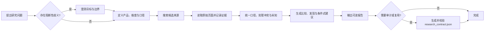

# Product Competitive Research Skill

面向产品研究场景的 AI Agent Skill，支持研究目标澄清、证据核验、多维度竞品比较与结构化报告生成，帮助用户高效完成有据可查的竞品分析。

[](skills/product-competitive-research/SKILL.md)
[](skills/product-competitive-research/scripts/validate_research.py)
[](CHANGELOG.md)
[](LICENSE)
[](tests/rubric.md)

> [!NOTE]
> Skill 是一组可复用的 AI 工作流与规则，不是独立 App，也不是所有 AI 聊天软件都能直接安装的普通提示词。研究所需的搜索、网页读取和文件能力由宿主 Agent 提供。

## 项目介绍

Product Competitive Research Skill 将公开资料竞品研究拆解为一套有边界、可追溯的工作流。用户给出产品、服务或研究问题后，Skill 会判断信息是否足够，确定研究范围，读取公开来源，比较差异，并输出带来源与限制说明的报告。

它重点解决竞品分析中常见的六类问题：目标模糊、比较口径不一致、搜索摘要被误当证据、资料互相冲突、未知信息被过度推断，以及结论无法回溯到来源。

当前经过真实模型测试的重点是**产品竞品分析**，包括主动澄清、明确维度比较和围绕用户任务的深度分析。产品选型及其他公开市场信息整理可沿用同一工作流；行业规模、市场预测、消费者调查等更广泛场景尚未经过充分验证。

## 核心功能

| 能力 | 实现方式 | 交付价值 |
| --- | --- | --- |
| 研究目标主动澄清 | 识别目标、产品身份或比较边界中的阻断性歧义；请求清晰时直接研究 | 避免生成方向正确但无法支持决策的泛化报告 |
| 证据来源管理 | 区分 `discovered`、`accessed` 与具体 claim 的 `verified` 状态，优先读取原始页面 | 保留来源—主张—结论的追溯关系 |
| 多维度竞品比较 | 统一套餐、地区、计费周期、版本、人数和功能口径；支持快速比较与深度分析 | 让价格、能力、限制与定位能够在同一口径下比较 |
| 冲突与未知信息处理 | 显式记录冲突；缺少资料时标为未知，不从页面沉默推断“不支持” | 降低过期信息和证据缺口造成的误判 |
| 结构化报告生成 | 按研究目标输出比较矩阵、发现、条件式建议、来源与限制 | 同时服务阅读、复核与后续决策 |
| Python 结果校验 | 使用 Python 3.10+ 标准库校验 Schema 1.1.0、状态和引用关系 | 在交付前发现结构错误和悬空引用 |

## 工作流程



工作流提供两种执行模式，但采用相同的证据标准：

- **快速比较**：适合已指定产品和少量明确维度的请求，默认输出简洁矩阵和结论。
- **深度分析**：适合定位、用户场景、业务流程、体验、策略或机会识别，展开完整研究框架。

## 效果展示

### 主动澄清示例

以下内容来自一次 V1.1 真实运行，经过节选，未改写模型行为。

**用户**

> 比较微信和小红书。

**Skill 先澄清**

> 你更想从哪个角度比较微信和小红书：**内容推荐与搜索、社交关系与互动，还是商业推广与获客**？也可以直接说你想用这个比较做什么决策。

**用户补充**

> 重点比较内容发现和搜索体验，面向内容产品规划。

**报告结论节选**

> 面向内容产品规划，小红书更值得研究“发现兴趣后，如何继续搜索和比较”；微信更值得研究“如何连接多种内容与服务，承接不同搜索意图”。这是基于公开产品结构的分析，不代表两者搜索效果已有实测排名。

查看[微信与小红书完整案例](examples/real-world/wechat-vs-xiaohongshu.md)。这是单次真实运行结果，不代表每次运行都会得到完全相同的表现。

### 报告结构预览

以下预览来自“B站与小红书收藏内容复访体验”报告。

| 报告部分 | 内容预览 |
| --- | --- |
| 研究目标 | 比较收藏内容、查找已收藏内容，以及后续重新使用内容的体验 |
| 分析框架 | 保存 → 组织 → 找回内容 → 定位有用部分 → 实际使用 |
| 主要发现 | B站更容易接上“继续观看、定位片段、复习知识”；小红书更贴近“归集攻略、现场查阅、共同决策” |
| 设计建议 | 允许用户保存收藏理由、视频时间点、图片页或段落，并提供直接返回该位置的入口 |
| 来源与限制 | 使用公开网页并注明来源；没有登录两款 App 做同版本实测，部分功能来自历史或第三方资料 |

查看[完整案例节选与证据限制](examples/real-world/bilibili-vs-xiaohongshu.md)。仓库还提供一个可用于校验流程的[合成报告](examples/case-03/report.md)及其[结构化研究记录](examples/case-03/research_contract.json)。

## 安装与使用

### 环境要求

你需要一个支持 Skills、能够读取本地文件的 AI Agent。研究最新公开信息时，宿主还需要提供网页搜索和正文读取能力。

当前真实模型测试主要在 Codex 环境完成；其他客户端的 Skill 目录、调用语法和工具能力可能不同。

| 客户端 | 当前验证状态 |
| --- | --- |
| Codex | 已完成 Skill 加载和真实模型行为测试；安装仍取决于 Agent 的文件与命令权限 |
| Claude Code | 支持同类 Skill 目录和显式调用；本项目尚未在该客户端运行测试 |
| 其他 AI 客户端 | 尚未核实，不提供兼容性承诺 |

### 方法一：让 Agent 检查并安装

将以下内容发送给你的 AI Agent：

```text
请阅读这个 GitHub 项目，帮我安装其中的 Product Competitive Research Skill：
https://github.com/Cineys/Product-Competitive-Research-Skill.git

先检查你是否支持 Skills，并确认安装位置和依赖。安装完成后告诉我如何调用它。
如果需要修改本地文件或执行命令，请先说明操作内容。
```

### 方法二：手动安装

```sh
git clone https://github.com/Cineys/Product-Competitive-Research-Skill.git
```

按照所用客户端的官方说明，将完整的 `skills/product-competitive-research/` 目录复制或链接到其 Skills 目录。不要只复制 `SKILL.md`，因为工作流还依赖 `references/`、`assets/` 和 `scripts/`。

> [!IMPORTANT]
> 安装前请确认项目来源。自然语言安装不代表应授予 Agent 不受限制的电脑权限；执行命令或修改文件前，请检查其准备进行的操作。

### 调用示例

安装后建议新建会话，并首次显式指定 Skill：

```text
使用 $product-competitive-research，比较微信和小红书的内容搜索体验。
```

更多可直接使用的任务：

```text
使用 $product-competitive-research，比较 Figma 和 Sketch 的价格及团队协作功能。

使用 $product-competitive-research，分析 B站和小红书的收藏管理体验，
重点关注用户如何再次找到收藏内容。

使用 $product-competitive-research，研究几款同类产品的主要差异，
帮我整理成一份带来源和限制说明的报告。
```

Codex 可使用 `$product-competitive-research`；Claude Code 的同类显式调用通常写作 `/product-competitive-research`。自动触发行为取决于客户端，显式调用更容易确认本次任务使用了该 Skill。

## 技术设计与边界

### 证据与结论分层

Skill 区分事实、厂商主张、分析推断和假设。搜索摘要只用于发现候选来源；页面能够打开，也不代表页面中的所有说法都已经得到验证。无法确认的信息保留为未知并说明限制。

默认交付是用户可读的 Markdown 报告。仅当任务需要审计或后续复用且环境可写时，才额外生成独立的 `research_contract.json`。

### Schema 1.1.0 与校验器

结构化研究记录包含研究范围、澄清状态、产品、维度、来源、主张、冲突、比较、发现、建议与限制。校验器可以检查：

- 必填字段、枚举值与 ID 唯一性；
- 来源访问状态与 claim 验证状态的约束；
- 来源、比较、发现和建议之间的引用关系；
- 价格冲突、未知能力和条件式建议的部分确定性规则。

校验通过只表示结构、状态与引用关系满足约束，**不等于**事实真实、引用在语义上支持主张或建议有效；重要决策仍需人工复核。

### 已知限制

- 真实模型测试主要在 Codex 中完成，单次运行不能证明稳定性。
- 来源身份规则已补充，但修改后的模型行为尚未重新测试。
- 公开资料研究不等于登录 App 后的同版本体验测试。
- 网页可能无法访问或已经过时，第三方资料也可能不准确。
- 宿主的搜索、页面读取、脚本和文件权限会影响实际表现。
- 尚未进行多次重复的正式行为评测，不能宣称 V1.1 稳定优于 V1。

## 项目结构

```text
Product-Competitive-Research-Skill/
├── skills/product-competitive-research/
│   ├── SKILL.md                     # Skill 入口与核心工作流
│   ├── references/                  # 澄清、证据与分析规则
│   ├── assets/report-template.md    # 报告模板
│   └── scripts/validate_research.py # Schema 1.1.0 校验器
├── examples/
│   ├── real-world/                  # 真实模型运行案例节选
│   └── case-03/                     # 合成报告与结构化记录
├── tests/                           # 单元测试、离线 fixture 与评测资料
├── tools/evaluation/                # 行为评测辅助工具
├── CHANGELOG.md
└── LICENSE
```

## 测试与验证

项目仅依赖 Python 3.10+ 标准库，不需要安装第三方 Python 包。

### 运行全部离线测试

```sh
python3 -m unittest -v
```

Windows 可将 `python3` 替换为 `py -3` 或可用的 `python` 命令。当前仓库包含 **56 项离线测试**，覆盖 Schema 约束、证据状态、冲突处理、fixture 完整性、运行隔离、结构化契约审计和文档本地链接。详见[测试与评测说明](tests/rubric.md)。

### 校验结构化研究记录

```sh
python3 skills/product-competitive-research/scripts/validate_research.py \
  examples/case-03/research_contract.json
```

### 已完成的行为验证

- 一次真实场景的主动澄清与多轮续接测试；
- 一次真实网页环境下的深度竞品分析测试；
- 一次 V1 与 V1.1 固定资料比较 Pilot；
- V1/V1.1 最小模型 Smoke Test。

这些结果不构成稳定性或统计显著性结论。完整变更与验证记录见 [CHANGELOG](CHANGELOG.md)。

## License

本项目采用 [MIT License](LICENSE)。

## 致谢

- [Anthropic Competitive Brief](https://github.com/anthropics/knowledge-work-plugins/blob/main/product-management/skills/competitive-brief/SKILL.md)
- [Browserbase Competitor Analysis](https://github.com/browserbase/skills/blob/main/skills/competitor-analysis/SKILL.md)
- [Agent Skills specification](https://agentskills.io/specification)

本仓库独立编写实现和合成测试资料，不包含以上项目的源码副本，也不依赖它们运行；致谢不代表相关组织背书。
